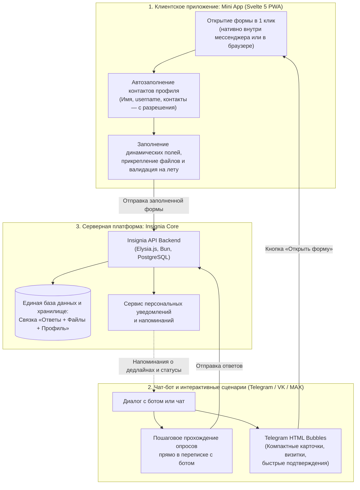
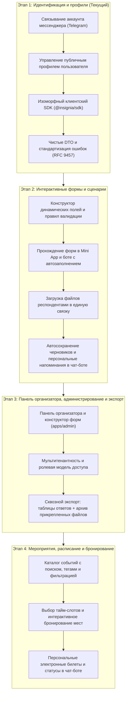

# Insignia

> **Insignia** — интерактивная омниканальная платформа для создания и прохождения динамических форм, опросов и пользовательских сценариев прямо внутри привычных мессенджеров (Telegram, в перспективе VK и MAX).

Платформа соединяет нативные интерфейсы мессенджеров, легковесные кроссплатформенные приложения (Mini Apps / PWA) и производительный серверный бэкенд в единую среду с нулевым трением для конечного пользователя.

---

## 🎯 Какую проблему мы решаем

Сегодня основными инструментами для сбора данных и регистрации остаются традиционные сервисы веб-форм, однако у них есть существенные системные ограничения:

- **Google Формы**:
    - **Ограничения доступа**: сервис нестабилен или заблокирован в РФ, несет регуляторные и инфраструктурные риски.
    - **Устаревший UX**: неадаптивный, аскетичный внешний вид без гибкой адаптации под бренд и мобильные экраны.
    - **Внешний барьер**: требует перехода во внешний браузер.
- **Яндекс Формы**:
    - **Засилье рекламы**: страницы форм перегружены рекламными баннерами, отвлекающими респондентов от сути.
    - **Сложный конструктор**: перегруженный интерфейс настройки полей и логики.
    - **Проблема экспорта файлов**: форма выгружает ответы в таблицу (Excel/CSV), но прикрепленные пользователями файлы сохраняются отдельной бессистемной россыпью на Яндекс Диске. Организаторам приходится вручную сопоставлять файлы со строками таблицы, что при больших объемах превращается в хаос.
- **Потеря контекста и конверсии**:
    - Чтобы распространить форму в каналах или рабочих чатах, автору приходится делиться ссылкой на сторонний ресурс.
    - Пользователь уходит из привычного мессенджера в браузер, теряет переписку, сталкивается с необходимостью заново вручную вбивать свое имя, телефон или никнейм — и может бросить заполнение на полпути.

### Подход Insignia:

1. **Заполнение внутри мессенджера**: форма запускается прямо в диалоге или чате Telegram (в перспективе MAX и VK). Пользователь нажимает кнопку и проходит форму во встроенном приложении (Mini App) без перехода во внешний браузер.
2. **Умное автозаполнение профиля**: система автоматически формирует базовый профиль респондента на основе его аккаунта мессенджера. Если форме требуются контакты (имя, username, телефон), платформа подставляет их автоматически (строго с согласия пользователя). Пользователю не нужно заново вводить информацию, которая уже есть в его профиле.
3. **Целостный экспорт данных**: ответы респондентов и все прикрепленные ими файлы логически связаны в единую структуру. Организатор получает готовый сквозной архив, где каждый файл четко сопоставлен с конкретной заявкой и анкетой.
4. **Чистый нативный интерфейс**: отсутствие посторонней рекламы, фокус на содержании и плавная работа интерфейса.

---

## 💡 Как это работает с точки зрения пользователя

Пользовательский путь спроектирован так, чтобы минимизировать любые рутинные действия и технические барьеры:

### 1. Клиентское приложение (Mini App / Web / PWA)

Основной рабочий инструмент для комфортного прохождения форм и взаимодействия со сложными интерактивными сценариями:

- 📱 **Запуск в один клик**: открывается прямо внутри мессенджера в виде нативного окна (Telegram Mini App) без перехода во внешний браузер.
- 🏎 **Скорость и плавность**: новейший реактивный движок Svelte 5 (Runes) гарантирует мгновенный отклик интерфейса, валидацию полей на лету и работу без подвисаний даже на смартфонах начального уровня.
- 📎 **Сложные сценарии и медиа**: многостраничные анкеты, условная логика ветвления полей, прикрепление файлов любого формата с моментальным предпросмотром.
- 🌐 **Платформенная независимость**: приложение (`apps/app`) построено как изолированный PWA-сервис. Сегодня оно нативно работает в Telegram, но архитектурно готово к развертыванию в обычном вебе, а также интеграции с VK Mini Apps, платформой MAX и другими средами.

### 2. Чат-бот и интерактивные диалоги

Полноценный сценарий взаимодействия и прохождения опросов прямо в переписке с ботом:

- 💬 **Прохождение опросов в чате**: пользователь может комфортно отвечать на вопросы шаг за шагом прямо в диалоге с ботом, без необходимости открывать дополнительные окна.
- ⏰ **Персональные напоминания**: бот ненавязчиво уведомит о приближающемся дедлайне или сохраненном черновике незавершенной анкеты.
- ⚡️ **Быстрые действия**: мгновенные голосования, подтверждение участия и смена статусов нажатием встроенных inline-кнопок.

### 3. Единый профиль и умное автозаполнение

- 🔑 **Вход без паролей**: бесшовная аутентификация через аккаунт мессенджера в одно касание.
- 📋 **Подстановка данных**: платформа автоматически подставляет известные контакты респондента в форму (с согласия пользователя), исключая необходимость вводить одни и те же данные повторно.
- 💾 **Сохранение черновиков**: прогресс заполнения формы фиксируется автоматически — респондент может свернуть приложение или прервать диалог с ботом и вернуться к заполнению позже без потери введенных данных.

### 4. Telegram HTML Bubbles (Компактные карточки и сниппеты)

Интерактивные пузыри сообщений (HTML Bubbles) используются для компактного визуального выстраивания информации в ленте и быстрой обратной связи:

- ⚡️ **Мгновенная загрузка (Zero latency)**: контент форматируется и мгновенно отдается прямо в ленте сообщений — без задержек на инициализацию внешних страниц или WebView.
- 📇 **Наглядные карточки и сниппеты**: визитки мероприятий, статус прохождения анкеты, интерактивные подтверждения участия и короткие опросы органично встраиваются в ленту переписки.
- 🔄 **Сохранение контекста**: подтверждения регистрации, сформированные билеты, ссылки на результаты и напоминания всегда под рукой в истории диалога.
- 🧩 **Компактное встраивание**: интерактивные сниппеты идеально подходят для быстрых микро-сценариев и наглядного статуса, дополняя возможности Mini App.

---

## 🗺 Дорожная карта реализации (Roadmap)

Развитие платформы разбито на последовательные пользовательские вертикальные срезы (**Vertical Slices**), каждый из которых обеспечивает законченную ценность для пользователей и организаторов:

- **Этап 1 (В процессе)**: Аутентификация через Telegram, профили пользователей, связка учетных записей, строгие контракты сетевого взаимодействия DTO, типизированный SDK и каноничный каталог ошибок по стандарту RFC 9457.
- **Этап 2**: Движок форм: правила валидации полей, автозаполнение контактных данных из профиля, прохождение анкет в Mini App и в диалоге с ботом, безопасная загрузка файлов, автосохранение черновиков и **персональные напоминания в чат-боте** о незаполненных формах и дедлайнах.
- **Этап 3**: Панель организатора и экспорт: визуальный конструктор и управление формами в панели администратора (`apps/admin`), мультитенантность для команд и организаций, разделение ролей и прав доступа, аналитика прохождения и **сквозной экспорт данных** (включая единый архив прикрепленных документов).
- **Этап 4**: Событийный слой: каталог мероприятий с поиском, тегами и фильтрацией, выбор свободных слотов времени, бронирование мест, подтверждение участия и персональные электронные билеты в чат-боте.

---

## 🏛 Инженерия и архитектура монорепозитория

Insignia построена как высокопроизводительный модульный монорепозиторий на базе современных технологий (**Bun**, **Elysia.js**, **Svelte 5**, **Prisma 8**, **PostgreSQL**, **Moonrepo**, **Mise**, **Fnox**).

Подробная документация для инженеров:

- 📖 **[Техническая архитектура и тулчейн (docs/architecture.md)](docs/architecture.md)** — архитектура монорепозитория, обоснование выбора инструментов, Docker и пошаговый запуск.
- 🚀 **[Руководство по онбордингу (docs/onboarding.md)](docs/onboarding.md)** — настройка локального окружения, ключей шифрования Age и частые вопросы.
- 🌿 **[Git Workflow и регламент веток (docs/git-workflow.md)](docs/git-workflow.md)** — регламент ветвления, Conventional Commits и процесс ревью PR.
- 👥 **[Реестр команды и зон ответственности (ROSTER.md)](ROSTER.md)** — матрица ответственности участников команды.
- 📐 **[Архитектурные решения (ADR)](docs/adr/)** — принятые архитектурные решения и проектный контекст.
- 📑 **[Интерактивная документация API (Scalar)](http://localhost:51000/docs)** — спецификация REST API и схем данных _(скоро появится, в разработке)_.
- 🔍 **[Каталог спецификаций ошибок RFC 9457](http://localhost:51000/problems)** — каноничный реестр кодов и типов проблем платформы _(скоро появится, в разработке)_.

---

## 📜 Лицензия

Проект распространяется под внутренней лицензией команды Insignia Core Team (`UNLICENSED`).
