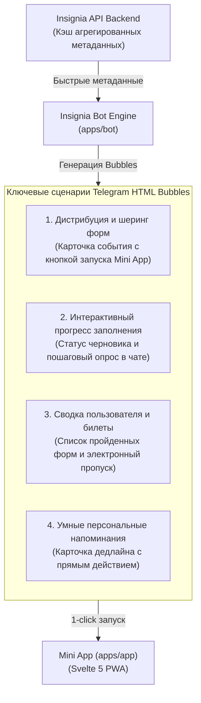

# [ADR-0012] Внедрение Telegram HTML Bubbles как слоя нативного интерактивного взаимодействия

- **Статус**: Предложено
- **Дата**: 2026-11-12
- **Авторы**: @naylour
- **Область (Scope)**: apps/bot | apps/app | apps/api | packages/contracts

---

## Контекст и проблематика

Платформа **Insignia** архитектурно спроектирована как мультиплатформенная среда с прицелом на поддержку различных каналов (Telegram, а в перспективе VK и MAX). Однако на текущем этапе реализации (MVP, Этапы 1–2) **Telegram является первостепенной средой запуска, тестирования и валидации ключевых пользовательских сценариев**.

Первоначально механизм **HTML Bubbles** (компактные интерактивные карточки-сообщения в ленте чата) рассматривался как вторичный или отложенный инструмент. Однако анализ продуктовых сценариев показал необходимость его **раннего внедрения уже на Этапе 2 (Интерактивные формы и сценарии)**.

Причины и предпосылки:

1. **Проблема информационной перегрузки в мессенджере (Chat Clutter)**:
   При пошаговом заполнении форм или отправке уведомлений бот склонен засорять диалог десятками последовательных текстовых сообщений. Это раздражает пользователей и приводит к потере контекста.
2. **«Слепота к ссылкам» (Link Blindness) при дистрибуции**:
   Публикация обычных текстовых ссылок на формы в групповых чатах и каналах имеет низкую кликабельность (CTR): пользователи не понимают объём анкеты, затраты времени, актуальность мероприятия и условия участия до момента перехода.
3. **Отсутствие наглядного персонального статуса**:
   Пользователь не видит сводки по своим текущим активностям (сохранённый черновик, статус отправленной заявки, подтверждённый электронный билет) без совершения явных и неудобных действий в меню бота.
4. **Уникальные возможности Telegram**:
   Именно экосистема Telegram предоставляет развитую связку инструментов: богатую разметку сообщений, механизм инлайн-запросов (`inline_query`), встроенные кнопки прямого запуска Web App (`web_app`) и тихое фоновое редактирование отправленных сообщений (`editMessageText`). В других платформах (VK, MAX) подобные механики имеют принципиально иную специфику или ограничения, поэтому фокус ранней интеграции делается строго на Telegram.

---

## Факторы принятия решения (Decision Drivers)

- **Ранняя интеграция (Early-stage Adoption)**: Внедрение слоя HTML Bubbles параллельно с движком форм (Этап 2), чтобы все создаваемые формы сразу обладали нативным представлением в Telegram.
- **Фокус на Telegram-экосистеме**: Реализация оптимизирована под нативные возможности Telegram Bot API и Telegram Mini Apps без оглядки на ограничения других каналов на этапе MVP.
- **Многофункциональность (Multi-purpose Use Cases)**: Использование HTML Bubbles не только для вирусной дистрибуции, но и для отображения живого прогресса прохождения, личного кабинета респондента и компактных напоминаний.
- **Динамическая контекстность (Dynamic Metadata)**: Карточка должна быть живой и информативной — отображать актуальный остаток мест, таймер дедлайна, процент прогресса черновика и социальные метрики.
- **Эргономика интерфейса (Zero-Latency UX)**: Мгновенное открытие полноценного Mini App (`apps/app`) по клику на кнопку действия внутри карточки без перехода во внешние браузеры.

---

## Рассмотренные варианты

### Вариант 1: Отложить HTML Bubbles до поздних этапов и использовать обычные сообщения бота

- **Описание**: Реализация стандартного бота с текстовыми вопросами и обычными гиперссылками на веб-форму.
- **Плюсы**:
    - Меньше первоначальной работы на этапе MVP.
- **Минусы**:
    - Потеря виральности и низкая конверсия первых форм.
    - Разрозненный пользовательский опыт: Mini App выглядит современно, а сообщения в боте — архаично.
    - Необходимость последующего масштабного рефакторинга сценариев бота и API.

### Вариант 2: Использование стандартных превью ссылок (OpenGraph)

- **Описание**: Полагаться на генерацию HTML-метатегов веб-страницы при отправке ссылки на форму.
- **Плюсы**:
    - Автоматическое формирование сниппета Telegram на основе URL.
- **Минусы**:
    - Telegram агрессивно кэширует метатеги OpenGraph на своих серверах: динамические параметры (остаток мест, число участников) невозможно обновлять в реальном времени.
    - Невозможность добавить нативную инлайн-кнопку вызова Mini App прямо в тело превью.

### Вариант 3: Полноценное внедрение слоя Telegram HTML Bubbles на ранних стадиях (Выбранный вариант)

- **Описание**: Разработка универсального модуля генерации интерактивных карточек (HTML Bubbles) в `apps/bot`, поддерживающего несколько ключевых бизнес-сценариев: дистрибуция, живой прогресс, история и уведомления.
- **Плюсы**:
    - Продуктовое единообразие: сообщения в чате и Mini App говорят на одном визуальном языке.
    - Высокая конверсия благодаря динамическим параметрам и социальному доказательству.
    - Чистота переписки: карточки обновляются на месте через `editMessageText`, не создавая спама.
- **Минусы**:
    - Необходимость проектирования лёгких эндпоинтов метаинформации в `apps/api` с кэшированием.
    - Контроль лимитов Telegram Bot API на частоту редактирования сообщений.

---

## Принятое решение

Принято решение **внедрить Telegram HTML Bubbles как ключевой слой интерактивного взаимодействия** в рамках **Этапа 2 (Интерактивные формы и сценарии)**.

### 1. Архитектура сценариев использования (Core Use Cases)

HTML Bubbles в Telegram покрывают 4 ключевых сценария:

#### Сценарий А: Дистрибуция и шеринг форм (Rich Sharing)

- Автор формы или участник нажимает «Поделиться» в приложении $\rightarrow$ запускается Telegram Inline Mode или диалог шеринга.
- В чат отправляется стилизованная карточка формы со свежими метриками:
    - ⏱ _Среднее время прохождения_ (например, `~2 мин`);
    - ⏳ _Таймер дедлайна_ (`Осталось 3 ч 15 мин`);
    - 👥 _Счётчик участников_ (`142 человека уже заполнили`);
    - 🎟 _Остаток квоты_ (`Осталось 8 мест`);
    - Нативная кнопка **«Пройти опрос»**, открывающая форму в Mini App.

#### Сценарий Б: Интерактивный прогресс прохождения (Live Survey Progress)

- При прохождении анкеты в диалоге с ботом либо при сохранении черновика в Mini App, Bubble в чате отображает актуальное состояние:
    - _«Анкета заполнена на 65% (осталось 2 вопроса)»_;
    - Кнопка **«Продолжить заполнение»** возвращает респондента точно на незаполненный шаг.
    - Сообщение обновляется на месте («in-place»), не засоряя чат новыми уведомлениями.

#### Сценарий В: Личный кабинет и история пользователя (User Portfolio & Passes)

- По команде `/my_forms` или через кнопку меню бот выводит единую сводную карточку:
    - Список пройденных и активных форм пользователя;
    - Статусы заявок (_«На рассмотрении»_, _«Одобрено»_);
    - Персональные электронные билеты / QR-коды для доступа на мероприятие;
    - Ссылки на выгрузку собственных ответов.

#### Сценарий Г: Умные персональные напоминания (Smart Reminders)

- За несколько часов до дедлайна или закрытия регистрации бот присылает персонализированную карточку с напоминанием и прямым действием на завершение формы.

---

### 2. Специфика реализации в Telegram

Поскольку реализация нацелена исключительно на Telegram:

1. **Разметка сообщений**: Используется строгий подмножество HTML Telegram (`<b>`, `<i>`, `<code>`, `<pre>`), структурированное в псевдографические блоки для создания иллюзии карточного интерфейса.
2. **Инлайн-режим (Inline Mode)**: Бот регистрирует обработчик `inline_query`, позволяя пользователям в любом чате ввести `@insignia_bot <form_id>` и мгновенно отправить интерактивный Bubble.
3. **Пакетное обновление (Throttled In-Place Edits)**: При изменении ключевых счетчиков (число участников, дедлайн) бот обновляет сообщения через `editMessageText` с интервалом не чаще 1 раза в 30 секунд на диалог, исключая превышение лимитов Telegram Bot API.

---

### 3. Интеграция с контрактами и сервисами монорепозитория

- **`packages/contracts`**:
    - `FormBubbleMetaDto`: компактная схема публичной информации формы (заголовок, статус, счетчики, время прохождения, дедлайн, условия).
    - `UserFormsSummaryDto`: схема сводки форм и билетов конкретного пользователя для отображения истории.
- **`apps/api`**:
    - Эндпоинт `GET /v1/forms/:id/bubble-meta` с кэшированием в памяти (TTL 15–30 с).
    - Эндпоинт `GET /v1/users/me/forms-summary` для личного кабинета.
- **`apps/bot`**:
    - Модуль шаблонизации `BubbleRenderer` для генерации текстовых карточек и инлайн-клавиатур.
    - Обработчики команд `/my_forms`, инлайн-запросов и сервиса обновлений.
- **`apps/app`**:
    - Интеграция с Telegram Mini Apps SDK для вызова нативного окна шеринга.

---

## Последствия и компромиссы

### Положительные последствия:

1. **Максимальная органичность в Telegram**: Пользователи взаимодействуют с платформой нативно, без ощущения чужеродных веб-интерфейсов.
2. **Чистота диалогов**: За счёт in-place обновлений (`editMessageText`) переписка с ботом остаётся аккуратной и структурированной.
3. **Высокая виральность**: Брендированные карточки с живыми параметрами привлекают внимание в каналах и стимулируют участие за счёт Social Proof и триггеров срочности.

### Отрицательные последствия и риски:

1. **Лимиты Telegram Bot API**: Необходимость аккуратного троттлинга и дебаунса при массовом обновлении сообщений.
2. **Платформенная привязка**: Логика HTML Bubbles проектируется под Telegram и не переносится напрямую в будущие среды (VK/MAX), где потребуются отдельные платформенные адаптеры.

---

## План внедрения на Этапе 2

1. **Шаг 1 (Контракты DTO)**: Объявление `FormBubbleMetaDto` и схем валидации в `packages/contracts/forms`.
2. **Шаг 2 (API эндпоинты)**: Реализация ручек метаинформации с кэшированием в `apps/api`.
3. **Шаг 3 (Движок Bubbles в боте)**: Разработка модуля `BubbleRenderer`, обработчиков `inline_query` и команды `/my_forms` в `apps/bot`.
4. **Шаг 4 (Шеринг в Mini App)**: Добавление кнопки «Поделиться в Telegram» в клиентском приложении `apps/app`.
5. **Шаг 5 (Тестирование)**: Проверка сценариев в тестовом окружении Telegram Test DC согласно ADR-0005.
